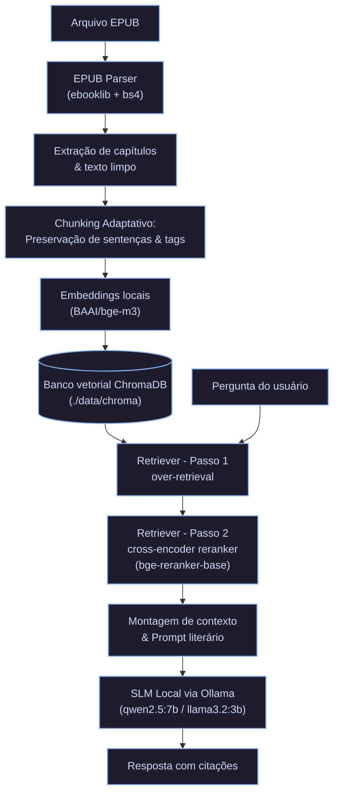

# TCC - Assistente Livros

#### Aluno: [Augusto Ben Hur Molinari dos Santos](https://github.com/AugustoMolinari/)
#### Orientadora: [Evelyn Batista](https://github.com/evysb)

---

Trabalho apresentado ao curso [GenAI e LLM MASTER](https://ica.ele.puc-rio.br/cursos/ia-generativa-large-language-models/) como pré-requisito para conclusão de curso e obtenção de crédito na disciplina "Projetos de Sistemas Inteligentes de Apoio à Decisão".

- [Link para o código](./src/).

---

### Resumo

Realizar buscas em livros de forma direta (com pesquisas como Ctrl+F) tende a não ter um resultado ideal, uma vez que a busca depende muito do contexto desejado, cenas, arcos narrativos e diálogos específicos, ao mesmo tempo em que o uso de modelos de linguagem em nuvem impõe custos recorrentes, possíveis questões de direitos autorais e riscos à privacidade de dados. Este trabalho apresenta o **Assistente Livros**, uma solução de *Retrieval-Augmented Generation (RAG)* voltada para o processamento de livros digitais (EPUB) que opera de forma totalmente local e offline em hardware de consumo.

A abordagem integra a extração estruturada de capítulos, uma estratégia de particionamento adaptativo (*chunking*) que preserva fronteiras de parágrafos e sentenças com injeção de metadados contextuais, busca vetorial em dois estágios no banco ChromaDB (recuperação densa com `BAAI/bge-m3` seguida de reranking via *cross-encoder* com `BAAI/bge-reranker-base`) e síntese textual orientada por *Small Language Models* (SLMs como `Qwen 2.5 7B` e `Llama 3.2 3B`) executados no Ollama. Nos benchmarks, o sistema alcançou até 100% de acurácia na identificação e citação dos capítulos canônicos e 92% de cobertura de conceitos-chave com o modelo Qwen 2.5 7B, garantindo respostas fundamentadas, com citações literais e sem dependência de infraestrutura externa.

### 1. Introdução

A experiência de consulta e exploração de narrativas extensas com ferramentas de busca textual estrita (como o comando Ctrl+F) não é muito útil quando se deseja buscar algo mais conceitual, como qual parte da história acontece uma cena, detalhes do que acontece após determinado momento, e questões como "em qual momento o protagonista adquire determinado objeto?", que seriam os casos mais comuns de busca em livros.

A utilização de modelos de linguagem de grande porte (LLMs) diretamente a esse domínio impõe desafios significativos. O envio de livros completos ou trechos volumosos para serviços comerciais em nuvem esbarra em barreiras de custos cumulativos de tokens por requisição, confidencialidade e direitos autorais. Além disso, a literatura possui particularidades de estrutura: a quebra arbitrária de textos em blocos genéricos de tamanho fixo frequentemente fragmenta diálogos ao meio e remove o contexto de autoria e localização temporal, provocando alucinações nas respostas.

Tendo isso em mente, o objetivo deste trabalho é implementar um assistente de perguntas e respostas para livros com operação estritamente local. A proposta visa unir ausência de custos e a privacidade total à capacidade de responder a questionamentos literários complexos, resgatando as passagens mais relevantes e citando com exatidão os capítulos e evidências textuais que sustentam cada resposta.

### 2. Modelagem

A arquitetura do sistema foi estruturada em um fluxo modular de ponta a ponta, abrangendo desde a ingestão do arquivo digital bruto até a síntese final da resposta fundamentada com citações. O diagrama a seguir ilustra o pipeline completo:



O funcionamento detalhado de cada componente, bem como as decisões e ajustes empíricos realizados durante o desenvolvimento, são descritos a seguir:

1. **Ingestão e Extração Estruturada (`EPUB Parser`)**:

   O módulo utiliza as bibliotecas `ebooklib` e `BeautifulSoup4` para ler os arquivos `.epub`. Em vez de converter todo o conteúdo em um único bloco contínuo, o parser processa os itens de navegação (NCX e NAV) e as divisões XHTML, eliminando tags irrelevantes (`<script>`, `<style>`, `<nav>`, cabeçalhos e rodapés de editora). Cada capítulo é isolado com seu respectivo índice, título canônico e texto limpo preservando quebras de parágrafo.

2. **Chunking Adaptativo**:

    Inicialmente, foram testados blocos maiores de aproximadamente 700 palavras/tokens com a recuperação de até 7 fragmentos. No entanto, notou-se um problema de dispersão semântica: blocos extensos acumulavam múltiplos temas e diálogos distintos, fazendo com que a similaridade ficasse em torno do mesmo valor para trechos completamente aleatórios da obra. Além disso, enviar muitos fragmentos longos saturava a janela de contexto do modelo prejudicando a precisão da resposta.

    Após realizar testes, o tamanho de bloco foi reduzido para aproximadamente 300 palavras, com  overlap de 50 palavras, preservando a sentenças e parágrafos. Isso garantiu que cada bloco representasse uma micro-cena coesa. O contexto final fornecido ao modelo foi reduzido para os 5 melhores trechos (`top_k = 5`), o que permitiu que ele produzisse respostas mais focadas e concisas. Cada fragmento recebe um header contextual embutido diretamente no texto vetorizado:
     ```text
     [Book: <Título da Obra> | Chapter: <Título do Capítulo>]
     <Texto do trecho narrativo...>
     ```

3. **Modelo de Embedding e Armazenamento Vetorial**:

   *Iterações de modelos*: O desenvolvimento iniciou com o modelo leve `BAAI/bge-small-en-v1.5`. Ao longo dos testes, foram avaliadas outras opções como `BAAI/bge-base-en-v1.5`, `sentence-transformers/all-mpnet-base-v2` e `WhereIsAI/UAE-Large-V1`.

   *Decisão*: Optou-se pelo `BAAI/bge-m3`, com o prefixo semântico do BGE (`"Represent this sentence for searching relevant passages: "`). Por ter sido observado uma melhor capacidade de capturar relações semânticas complexas na prosa literária. Os vetores normalizados e os metadados (identificador do livro, capítulo, contagem de palavras) são persistidos no banco vetorial **ChromaDB** com métrica de distância por cosseno (`hnsw:space: cosine`).

4. **Estratégia de Recuperação**:

   Na versão inicial, utilizava-se apenas uma busca vetorial direta no banco, retornando diretamente o `top_k`. Essa abordagem frequentemente recuperava trechos com correspondência superficial de vocabulário, mas semanticamente irrelevantes para o evento específico questionado (em muitos casos, de capítulos completamente espalhados).

   Visando solucionar isso, foi adotada uma solução em duas etapas:
     - **Passo 1 (Over-retrieval)**: Uma a busca vetorial recupera uma janela ampliada de trechos candidatos, `fetch_k = 20`.
     - **Passo 2 (Reranking)**: São criados 20 pares de `(pergunta, trecho)` e processados pelo modelo `BAAI/bge-reranker-base` com atenção cruzada total, reclassificando os candidatos por pontuação real de relevância semântica, e filtrando os 5 melhores (`top_k = 5`) para serem enviados para o modelo.

5. **Engenharia de Prompt Literário e Contextualização**:

   Os trechos selecionados são injetados em um prompt especializado instruindo o modelo a:
    - Citar obrigatoriamente o capítulo exato indicado no trecho
    - Descrever o contexto dramático e os personagens presentes
    - Citar evidências textuais literais
    - Reconhecer ausência de informação quando os trechos forem insuficientes

6. **Inferência com SLMs Locais**:

   A geração ocorre via daemon local do **Ollama** com aceleração na GPU, suportando alternância em tempo de execução. Esse projeto sendo baseado entre o ágil `Llama 3.2 3B` e o analítico `Qwen 2.5 7B`.

### 3. Resultados

Para avaliar quantitativamente a arquitetura implementada, foi desenvolvido um fluxo de benchmark, executado diretamente na máquina de teste com aceleração de hardware em uma GPU NVIDIA GeForce RTX 2070 (8 GB VRAM).

#### Setup Experimental e Metodologia de Avaliação
- **Base de Dados de Teste**: Obra clássica em domínio público *Alice's Adventures in Wonderland* (Lewis Carroll), ingerida e indexada em 13 capítulos e 60 chunks vetoriais.

- **Transição de RAGAS para Golden Dataset Determinístico**:

  Durante o projeto, houve a tentativa de utilização do framework **RAGAS** (*Retrieval Augmented Generation Assessment*) para avaliação automatizada baseada em *LLM-as-a-judge*. Porém, A execução local do RAGAS demandava carregar um modelo avaliador simultaneamente ou em alternância estrita com o modelo gerador dentro dos limites de 8 GB de VRAM. Modelos menores (3B ou 7B quantizados) atuando como "juízes" apresentaram inconsistências frequentes e falhavam em responder no formato esperado, e modelos maiores não cabiam na memória disponível.

  Então, optou-se por estabelecer um *Golden Dataset* curado de 10 perguntas analíticas cobrindo eventos específicos do Capítulo I ao XI. Cada pergunta conta com capítulo canônico esperado, resposta padrão e conjunto de palavras-chave essenciais, permitindo checagens diretas, repetíveis e determinísticas somadas à verificação qualitativa manual.

- **Métricas de Desempenho e Qualidade**:
  1. *Time to First Token (TTFT)*: Tempo decorrido em milissegundos até a emissão do primeiro token.
  2. *Throughput de Geração*: Taxa de velocidade em tokens por segundo (tok/s).
  3. *Latência Total Média*: Duração média em segundos para a conclusão da resposta.
  4. *Pico de Alocação de VRAM*: Memória de vídeo consumida durante a execução.
  5. *Acurácia de Capítulo*: Percentual de respostas em que o modelo citou corretamente o capítulo exato do evento.
  6. *Cobertura Média de Palavras-chave*: Proporção de palavras-chave essenciais contemplados na resposta.
  7. *Similaridade Semântica*: Similaridade por cosseno entre o vetor da resposta gerada e o da resposta esperada (via modelo de embeddings).

#### Comparativo entre Modelos
A tabela a seguir apresenta os resultados consolidados no benchmark comparativo entre o `Llama 3.2 3B` e o `Qwen 2.5 7B`:

| Métrica Avaliada | Llama 3.2 (3B) | Qwen 2.5 (7B) | Melhor Desempenho |
| :--- | :---: | :---: | :---: |
| **Tempo até o 1º Token (TTFT)** | **445,5 ms** | 2.420,4 ms | **Llama 3.2 3B** (-81,6%) |
| **Velocidade de Geração** | **71,9 tok/s** | 39,3 tok/s | **Llama 3.2 3B** (+82,9%) |
| **Latência Média por Consulta** | **7,06 s** | 12,48 s | **Llama 3.2 3B** (-43,4%) |
| **Pico de Memória de Vídeo (VRAM)** | ~7.703 MB | ~7.709 MB | (limitado pela GPU) |
| **Acurácia de Citação de Capítulo** | 70,0% | **100,0%** | **Qwen 2.5 7B** (+30,0 p.p.) |
| **Cobertura de Palavras-chave** | 90,3% | **92,0%** | **Qwen 2.5 7B** (+1,7 p.p.) |
| **Similaridade Semântica Média** | **0,755** | 0,754 | — |

Os resultados mostram que a combinação de *overfetching* com *cross-encoder* forneceu os trechos relevantes para ambos os modelos, garantindo uma similaridade semântica em torno de 0,75 em ambos os casos. Porém, houve disparidades expressivas no comportamento qualitativo e temporal.

### 4. Conclusões

A análise dos resultados e a trajetória de desenvolvimento evidenciam lições de engenharia e trade-offs fundamentais na implementação de um RAG local para literatura:

1. **Desempenho e Precisão (Qwen 2.5 7B vs. Llama 3.2 3B)**:

   O `Qwen 2.5 7B` atingiu 100% na identificação e citação dos capítulos corretos em todas as 10 perguntas do benchmark. Sua capacidade aprimorada de seguir instruções complexas permitiu extrair dos metadados a localização da cena e responder com descrições mais ricas e fundamentadas.

   Em contrapartida, o `Llama 3.2 3B`, embora tenha alcançado similaridade semântica equivalente, apresentou falhas de atribuição em 30% das perguntas, as vezess confundindo referências temporais ou omitindo a numeração exata do capítulo.

2. **Trade-offs de Latência, Qualidade e Usabilidade**:

   O `Llama 3.2 3B` destacou-se pela velocidade, com TTFT inferior a meio segundo (445,5 ms) e throughput de 71,9 tokens/s, passando uma sensação de resposta instantânea melhor para conversação interativa em tempo real. Enquanto o `Qwen 2.5 7B` demanda cerca de 12 segundos por consulta completa, sendo preferencial para cenário que deseja-se uma precisão/qualidade maior ou perguntas isoladas/pontuais.

3. **Lições de Engenharia sobre Chunking e Retrieval**:

   A experiência com blocos de ~700 palavras demonstrou que textos literários requerem uma maior granularidade, em média de ~300 palavras, e blocos muito grandes homogeneízam as distâncias vetoriais e saturam o contexto.

   A substituição da busca vetorial direta, por uam abordagem em duas etapas (*over-retrieval* com `k=20`, seguido de *reranker* para `k=5`). Junto à transição do `bge-small` para o `bge-m3`, com a utilização de um prefixo de instrução na busca. Foram fatores determinantes para melhorar a qualidade do contexto entregue ao modelo.

4. **Desafios de Avaliação e Hardware**: A inviabilidade do RAGAS com *LLM-as-a-judge* de forma consistente/coerente em GPU de consumo de 8 GB demonstrou que a avaliação de modelos locais pode se beneficiar mais de *golden datasets* reprodutíveis com validação programática e manual, do que de cadeias avaliativas automatizadas instáveis.

5. **Próximos Passos**:
   Como trabalhos futuros, propõe-se:

   - A introdução de busca híbrida combinando *BM25* com embeddings densos para otimizar o resgate de termos raros e nomes próprios;
   - Suporte a histórico conversacional multi-turn com consolidação de memória semântica;
   - Melhorar o entendimento do relacionamento entre os capítulos, ordem dos acontecimentos, etc;
   - Expandir a biblioteca para permitir consultas entre múltiplos volumes ou sagas;

---

Matrícula: 252.100.263

Pontifícia Universidade Católica do Rio de Janeiro

Curso de Pós Graduação *Inteligência Artificial Generativa & Large Language Models*
